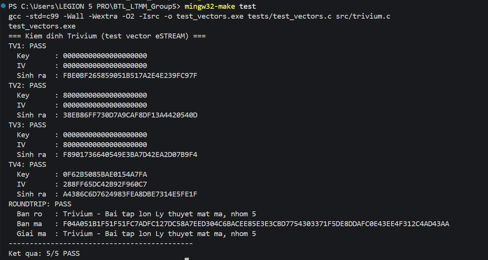
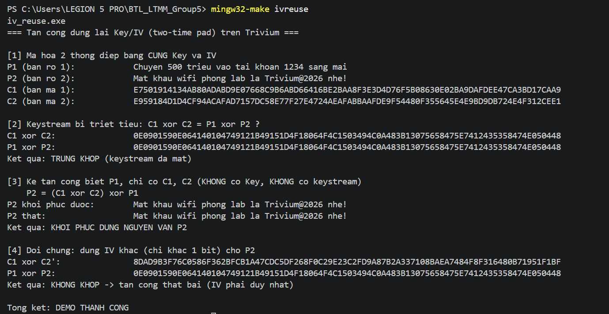

# Giải thích phần Kiểm định và Tấn công dùng lại IV
*Người thực hiện: Phan Anh Hào — Nhóm 5, BTL Lý thuyết mật mã*
*File: `tests/test_vectors.c`, `tools/iv_reuse.c`*

## 1. Phần này làm gì, nằm ở đâu trong hệ thống

Phần của em gồm hai chương trình độc lập, đều **chỉ gọi** các hàm chung trong `src/trivium.h` do Giang cài đặt (`trivium_init`, `trivium_keystream`, `trivium_crypt`) và **không chương trình nào khác gọi lại** chúng.

- `tests/test_vectors.c` — kiểm định tính đúng đắn: so keystream mà `trivium.c` sinh ra với 4 test vector chuẩn của eSTREAM, thêm một phép thử mã hóa rồi giải mã.
- `tools/iv_reuse.c` — minh họa vì sao **không được dùng lại cặp (Key, IV)**: từ hai bản mã cùng keystream, kẻ tấn công khôi phục được bản rõ mà không cần khóa.

Hai chương trình chỉ đọc kết quả của `trivium.c`, nên nếu Giang sửa thuật toán thì em chạy lại là biết ngay còn đúng hay không.

## 2. Cách chạy

| Lệnh (Windows / WSL) | Tác dụng |
|---|---|
| `mingw32-make test` / `make test` | Build và chạy `test_vectors` |
| `mingw32-make ivreuse` / `make ivreuse` | Build và chạy `iv_reuse` |

`test_vectors` trả về mã thoát 0 nếu mọi test PASS, khác 0 nếu có FAIL. Kết quả khi chạy với `src/trivium.c` của Giang (5/5 PASS, mã thoát 0):

```
=== Kiem dinh Trivium (test vector eSTREAM) ===
TV1: PASS
  Key      : 00000000000000000000
  IV       : 00000000000000000000
  Sinh ra  : FBE0BF265859051B517A2E4E239FC97F
TV2: PASS   (Sinh ra: 38EB86FF730D7A9CAF8DF13A4420540D)
TV3: PASS   (Sinh ra: F8901736640549E3BA7D42EA2D07B9F4)
TV4: PASS   (Sinh ra: A4386C6D7624983FEA8DBE7314E5FE1F)
ROUNDTRIP: PASS
  Ban ro   : Trivium - Bai tap lon Ly thuyet mat ma, nhom 5
  Ban ma   : F04A051B1F51F51FC7ADFC127DC58A7EED304C6B...
  Giai ma  : Trivium - Bai tap lon Ly thuyet mat ma, nhom 5
--------------------------------------------
Ket qua: 5/5 PASS
```

Khi một vector FAIL, chương trình in thêm dòng `Mong doi :` để so sánh với dòng `Sinh ra :`.

`iv_reuse` in 4 bước; đoạn chính:

```
C1 xor C2:  0E0901590E064140104749121B49151D4F18064F4C15...
P1 xor P2:  0E0901590E064140104749121B49151D4F18064F4C15...
Ket qua: TRUNG KHOP (keystream da mat)
P2 khoi phuc duoc:  Mat khau wifi phong lab la Trivium@2026 nhe!
Ket qua: KHOI PHUC DUNG NGUYEN VAN P2
```
# Ảnh khi chạy make test ở file test_vectors

# Ảnh khi chạy make ivreuse ở file iv-reuse

## 3. Giải thích từng đoạn chính

**`test_vectors.c`**

Mảng VECTORS[]: mỗi phần tử gồm tên, Key 10 byte, IV 10 byte và keystream mong đợi 16 byte, chép nguyên từ tests/vectors.txt (thứ tự byte giữ đúng như chuỗi hex trong file).
run_vector(): gọi trivium_init(ctx, key, iv) (nạp Key/IV + 1152 vòng khởi tạo), rồi trivium_keystream(ctx, out, 16), so bằng memcmp. 16 byte này là R₀ … R₁₅ với Rᵢ = Σ (2ʲ · r₈ᵢ₊ⱼ), j = 0…7, theo quy ước LSb-first (mục 2.3 trong trivium_tomtat.md): bit sinh ra đầu tiên nằm ở bit thấp nhất của byte đầu.
run_roundtrip(): mã hóa một chuỗi bằng trivium_crypt, khởi tạo lại cùng (Key, IV), gọi trivium_crypt lần nữa trên bản mã. Vì (P ⊕ K) ⊕ K = P nên phải ra đúng chuỗi gốc. Em kiểm thêm rằng bản mã khác bản rõ, để loại trường hợp keystream toàn 0 (khi đó "giải mã đúng" nhưng thực chất chưa mã hóa gì).

Quy ước nạp Key/IV (rất dễ sai). Để khớp 4 vector, bit thứ i của đặc tả (kᵢ, vᵢ với i = 0…79) phải lấy từ mảng byte như sau:

k_i = (key[9 - i/8] >> (7 - i%8)) & 1        (i/8 là chia nguyên)
v_i = (iv [9 - i/8] >> (7 - i%8)) & 1

Nghĩa là byte cuối của chuỗi hex ứng với các bit đầu của đặc tả, và trong mỗi byte bit cao (MSB) đi trước. Em đã thử các cách nạp khác nhau trên một bản đối chiếu viết riêng theo đặc tả (không đưa vào repo): chỉ cách nạp này cho 4/4 vector PASS, và trivium.c của Giang dùng đúng quy ước đó. Trong trivium.c, k₀…k₇₉ nạp vào s[0..79] (thanh ghi A), v₀…v₇₉ vào s[93..172] (thanh ghi B), còn s[285], s[286], s[287] đặt bằng 1 (3 bit cuối của thanh ghi C), khớp mục 3.1 trong tóm tắt đặc tả.

**`iv_reuse.c`**

- *Bước 1*: gọi `trivium_init` với cùng (Key, IV) trước mỗi lần mã hóa → C₁ = P₁ ⊕ K và C₂ = P₂ ⊕ K, với cùng một keystream K.
- *Bước 2*: C₁ ⊕ C₂ = (P₁ ⊕ K) ⊕ (P₂ ⊕ K) = P₁ ⊕ P₂, vì K ⊕ K = 0 nên keystream triệt tiêu.
- *Bước 3*: biết P₁ thì P₂ = (C₁ ⊕ C₂) ⊕ P₁. Đoạn này **không dùng Key và không dùng keystream**, chỉ dùng hai bản mã và P₁.
- *Bước 4 (đối chứng)*: đổi IV chỉ 1 bit cho P₂ thì C₁ ⊕ C₂′ ≠ P₁ ⊕ P₂ (C₂′ là bản mã của P₂ với IV mới), nên tấn công thất bại.

## 4. Code tham khảo lấy từ đâu, đã sửa gì

- **Dữ liệu test vector** lấy từ thư viện mã nguồn mở *avr-crypto-lib*, file `testvectors/trivium-80.80.test-vectors` (link trong `tests/vectors.txt`), là bộ vector của eSTREAM: TV1 = Set 2 vector 0, TV2 = Set 1 vector 0, TV3 = Set 5 vector 0, TV4 = Set 6 vector 3. Em chỉ chép số liệu, không dùng mã nguồn của thư viện đó.
- **Mã chương trình** `test_vectors.c` và `iv_reuse.c` do em viết theo interface `trivium.h` đã chốt, không sao chép từ nguồn nào. 

