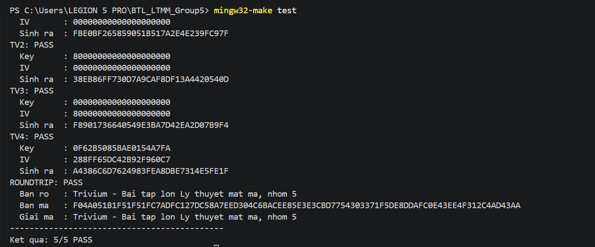

# Giải thích phần Kiểm định và Tấn công dùng lại IV
*Người thực hiện: Phan Anh Hào — Nhóm 5, BTL Lý thuyết mật mã*
*File: `tests/test_vectors.c`, `tools/iv_reuse.c`*

## 1. Phần này làm gì, nằm ở đâu trong hệ thống

Phần của em gồm hai chương trình độc lập, đều **chỉ gọi** các hàm chung trong `src/trivium.h` do Giang cài đặt (`trivium_init`, `trivium_keystream`, `trivium_crypt`) và **không chương trình nào khác gọi lại** chúng.

- `tests/test_vectors.c` — kiểm định tính đúng đắn: so keystream mà `trivium.c` sinh ra với 4 test vector chuẩn của eSTREAM, thêm một phép thử mã hóa rồi giải mã.
- `tools/iv_reuse.c` — minh họa vì sao **không được dùng lại cặp (Key, IV)**: từ hai bản mã cùng keystream, kẻ tấn công khôi phục được bản rõ mà không cần khóa.

Hai chương trình chỉ đọc kết quả của `trivium.c`, nên nếu Giang sửa thuật toán thì em chạy lại là biết ngay còn đúng hay không.

## 2. Cách chạy

| Lệnh (Windows / WSL) | Tác dụng |
|---|---|
| `mingw32-make test` / `make test` | Build và chạy `test_vectors` |
| `mingw32-make ivreuse` / `make ivreuse` | Build và chạy `iv_reuse` |

`test_vectors` trả về mã thoát 0 nếu mọi test PASS, khác 0 nếu có FAIL. Kết quả khi chạy với `src/trivium.c` của Giang (5/5 PASS, mã thoát 0):

```
=== Kiem dinh Trivium (test vector eSTREAM) ===
TV1: PASS
  Key      : 00000000000000000000
  IV       : 00000000000000000000
  Sinh ra  : FBE0BF265859051B517A2E4E239FC97F
TV2: PASS   (Sinh ra: 38EB86FF730D7A9CAF8DF13A4420540D)
TV3: PASS   (Sinh ra: F8901736640549E3BA7D42EA2D07B9F4)
TV4: PASS   (Sinh ra: A4386C6D7624983FEA8DBE7314E5FE1F)
ROUNDTRIP: PASS
  Ban ro   : Trivium - Bai tap lon Ly thuyet mat ma, nhom 5
  Ban ma   : F04A051B1F51F51FC7ADFC127DC58A7EED304C6B...
  Giai ma  : Trivium - Bai tap lon Ly thuyet mat ma, nhom 5
--------------------------------------------
Ket qua: 5/5 PASS
```

Khi một vector FAIL, chương trình in thêm dòng `Mong doi :` để so sánh với dòng `Sinh ra :`.

`iv_reuse` in 4 bước; đoạn chính:

```
C1 xor C2:  0E0901590E064140104749121B49151D4F18064F4C15...
P1 xor P2:  0E0901590E064140104749121B49151D4F18064F4C15...
Ket qua: TRUNG KHOP (keystream da mat)
P2 khoi phuc duoc:  Mat khau wifi phong lab la Trivium@2026 nhe!
Ket qua: KHOI PHUC DUNG NGUYEN VAN P2
```
# Ảnh khi chạy make test ở file test_vectors



## 3. Giải thích từng đoạn chính

**`test_vectors.c`**

- *Mảng `VECTORS[]`*: mỗi phần tử gồm tên, Key 10 byte, IV 10 byte và keystream mong đợi 16 byte, chép nguyên từ `tests/vectors.txt` (thứ tự byte giữ đúng như chuỗi hex trong file).
- *`run_vector()`*: gọi `trivium_init(ctx, key, iv)` (nạp Key/IV + 1152 vòng khởi tạo), rồi `trivium_keystream(ctx, out, 16)`, so bằng `memcmp`. 16 byte này là $R_0 \dots R_{15}$ với $R_i = \sum_{j=0}^{7} 2^j r_{8i+j}$ (quy ước **LSb-first**, mục 2.3 trong `trivium_tomtat.md`), nên bit sinh ra đầu tiên nằm ở bit thấp nhất của byte đầu.
- *`run_roundtrip()`*: mã hóa một chuỗi bằng `trivium_crypt`, khởi tạo lại cùng (Key, IV), gọi `trivium_crypt` lần nữa trên bản mã. Vì $(P \oplus K) \oplus K = P$ nên phải ra đúng chuỗi gốc. Em kiểm thêm rằng bản mã **khác** bản rõ, để loại trường hợp keystream toàn 0 (khi đó "giải mã đúng" nhưng thực chất chưa mã hóa gì).

**Quy ước nạp Key/IV (rất dễ sai).** Để khớp 4 vector, bit thứ $i$ của đặc tả ($k_i$, $v_i$ với $i = 0 \dots 79$) phải lấy từ mảng byte như sau: $k_i = (\text{key}[9 - \lfloor i/8 \rfloor] \gg (7 - i \bmod 8)) \,\&\, 1$, và tương tự cho IV. Nghĩa là **byte cuối của chuỗi hex ứng với các bit đầu** của đặc tả, và trong mỗi byte bit cao đi trước. Em đã thử các cách nạp khác nhau trên một bản đối chiếu viết riêng theo đặc tả (không đưa vào repo): chỉ cách nạp này cho 4/4 vector PASS, và `trivium.c` của Giang dùng đúng quy ước đó. Trong `trivium.c` $k_0 \dots k_{79}$ nạp vào `s[0..79]` (thanh ghi A), $v_0 \dots v_{79}$ vào `s[93..172]` (thanh ghi B), còn `s[285], s[286], s[287]` đặt bằng 1 (3 bit cuối của thanh ghi C), khớp mục 3.1 trong tóm tắt đặc tả.

**`iv_reuse.c`**

- *Bước 1*: `trivium_init` với cùng (Key, IV) trước mỗi lần mã hóa → $C_1 = P_1 \oplus K$, $C_2 = P_2 \oplus K$ với cùng keystream $K$.
- *Bước 2*: $C_1 \oplus C_2 = (P_1 \oplus K) \oplus (P_2 \oplus K) = P_1 \oplus P_2$ vì $K \oplus K = 0$.
- *Bước 3*: biết $P_1$ thì $P_2 = (C_1 \oplus C_2) \oplus P_1$. Đoạn này **không dùng Key và không dùng keystream**, chỉ dùng hai bản mã và $P_1$.
- *Bước 4 (đối chứng)*: đổi IV chỉ 1 bit cho $P_2$ thì $C_1 \oplus C_2' \neq P_1 \oplus P_2$, tấn công thất bại.

## 4. Code tham khảo lấy từ đâu, đã sửa gì

- **Dữ liệu test vector** lấy từ thư viện mã nguồn mở *avr-crypto-lib*, file `testvectors/trivium-80.80.test-vectors` (link trong `tests/vectors.txt`), là bộ vector của eSTREAM: TV1 = Set 2 vector 0, TV2 = Set 1 vector 0, TV3 = Set 5 vector 0, TV4 = Set 6 vector 3. Em chỉ chép số liệu, không dùng mã nguồn của thư viện đó.
- **Mã chương trình** `test_vectors.c` và `iv_reuse.c` do em viết theo interface `trivium.h` đã chốt, không sao chép từ nguồn nào. *(Hào tự ghi thêm nếu có dùng công cụ hỗ trợ, theo yêu cầu của môn học.)*

## 5. Câu hỏi cô có thể hỏi

**1. Vì sao khớp test vector thì tin code đúng?**
Keystream là kết quả của 1152 vòng khởi tạo + các vòng sinh bit, mỗi vòng trộn phi tuyến (phép AND) nhiều bit. Chỉ cần sai một chỉ số lấy mẫu, một bit nạp Key/IV hay thứ tự ghép bit thành byte thì sau hàng nghìn vòng, kết quả đầu ra gần như chắc chắn lệch hoàn toàn (hiệu ứng thác lũ), xác suất trùng ngẫu nhiên 128 bit là $2^{-128}$. Vector do bên độc lập (eSTREAM) tạo ra nên khớp là bằng chứng mạnh. Tuy vậy đây vẫn là *kiểm thử*, chỉ chứng minh đúng trên các đầu vào đã thử, không phải chứng minh hình thức.

**2. Vì sao phải có vector IV khác 0?**
TV1 (Key = IV = 0) chỉ kiểm tra được hằng số khởi tạo (3 bit 1 của thanh ghi C), các điểm lấy mẫu và 1152 vòng. Nếu cài sai chỗ nạp IV (nhầm vị trí, nhầm thứ tự bit, quên nạp IV), TV1 vẫn PASS. TV3 (IV MSB = 1) và TV4 (IV ngẫu nhiên) mới bắt được lỗi đó, tương tự TV2/TV4 với Key.

**3. Vì sao dùng lại Key/IV thì lộ bản rõ?**
Mã dòng đồng bộ sinh keystream chỉ phụ thuộc (Key, IV). Cùng cặp thì cùng keystream $K$, nên $C_1 \oplus C_2 = P_1 \oplus P_2$ và $K$ biến mất. Khi đó chỉ cần đoán được một phần $P_1$ (đầu thư, định dạng file…) là suy ra phần tương ứng của $P_2$, rồi lan dần bằng phân tích thống kê. Đây là tấn công *two-time pad*.

**4. Vậy dùng Trivium an toàn thế nào?**
Mỗi thông điệp một IV duy nhất với cùng một khóa (IV không cần bí mật, có thể gửi kèm bản mã). Kiểm chứng ở bước 4: IV chỉ khác 1 bit đã cho keystream hoàn toàn khác.

**5. Nếu cài sai thứ tự nạp Key/IV thì test báo gì?**
TV1 (toàn 0) vẫn PASS nhưng TV2, TV3, TV4 FAIL, vì với Key/IV toàn 0 thì thứ tự bit không có ý nghĩa. Em đã thử cách nạp `key[i/8]` (không đảo byte) trên bản đối chiếu và thấy đúng hiện tượng này, nên 4 vector cùng nhau mới đủ sức bắt lỗi nạp Key/IV. Ngoài ra, nếu `trivium.c` chưa cài thật (keystream toàn 0) thì cả 5 test đều FAIL, kể cả ROUNDTRIP vì bản mã trùng bản rõ.
